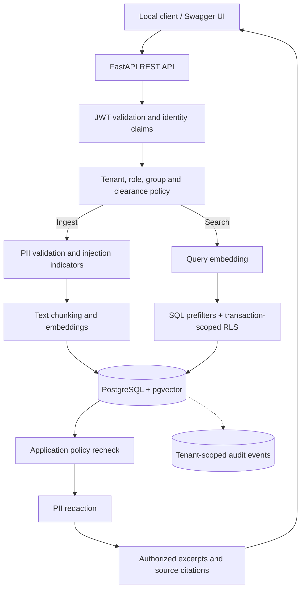

# Secure Enterprise RAG Platform

**Languages represented in this repository:**
  

**A local-first, multi-tenant document retrieval API that protects sensitive information before it reaches a search result.**

The platform combines authenticated access, document classification, group-based permissions, PostgreSQL row-level security (RLS), vector search, PII redaction, and audit events. It is designed for **local learning, development, and security demonstrations using synthetic data**.

> **What it returns:** authorized document excerpts with source citations. The current application uses *extractive retrieval*; it does not generate answers with an LLM or run autonomous agents.

## What this project does

The application accepts plain-text documents, divides them into searchable chunks, stores vector representations in PostgreSQL with pgvector, and exposes authenticated endpoints for searching and retrieving document metadata.

It addresses common problems in multi-tenant document search:

| Problem | How the project addresses it |
| --- | --- |
| One customer could see another customer's documents | Binds tenant identity to a verified JWT and applies transaction-scoped PostgreSQL RLS and tenant filters. |
| A valid user could retrieve documents outside their department | Checks allowed groups and document classification against the user's claims before vector ranking; checks authorization again before returning excerpts. |
| Search results could reveal personal information | Detects sample email addresses, SSNs, and Luhn-valid payment card numbers; blocks sensitive content at low classifications and masks supported patterns in returned excerpts. |
| Source content could contain instructions targeting an AI assistant | Flags example prompt-injection phrases as warnings; source text is treated as data and never executed as instructions. |
| Search results need to be traceable | Returns document IDs, source names, chunk positions, and similarity scores; stores SHA-256 content hashes and tenant-scoped audit records. |
| A full external AI stack may be unavailable | Runs with deterministic local hash embeddings and optionally connects to a local Ollama embedding model. |

### Main API endpoints

| Endpoint | Purpose |
| --- | --- |
| `POST /v1/documents` | Ingest an authorized, classified plain-text document. |
| `POST /v1/query` | Retrieve the best matching **authorized** excerpts and citations. |
| `GET /v1/documents/{document_id}` | View document metadata when permitted. |
| `GET /v1/audit` | View tenant-scoped audit events with the `security_auditor` role. |
| `GET /health/live` | Application liveness check. |
| `GET /health/ready` | Database readiness check. |
| `GET /docs` | Interactive OpenAPI documentation (Swagger UI). |

## Technology stack

| Layer | Technologies |
| --- | --- |
| API | Python 3.12, FastAPI, Pydantic, Uvicorn |
| Authentication and permissions | PyJWT, signed JWT claims, role/group/classification policy |
| Database and vector search | PostgreSQL 16, pgvector, HNSW cosine-similarity index, SQL, RLS |
| Data processing | Plain-text chunking, SHA-256 source hashes, basic regex-based PII detection and redaction |
| Embeddings | Built-in 384-dimensional lexical hash embedder; optional local Ollama 384D model |
| Local infrastructure | Docker Desktop, Docker Compose |
| Testing and code checks | Pytest, Ruff, Bandit, HTTP integration tests |

## Architecture



### How the request flows

1. **Authenticate:** the API validates a bearer token and reads the user's tenant, groups, roles, and clearance from the signed token—not from a client-supplied tenant parameter.
2. **Ingest:** a user with the `data_steward` role uploads a classified text document. The API checks permissions, performs basic PII checks, splits the text into chunks, computes embeddings, and stores source metadata and hashes.
3. **Search:** the user's question is embedded. PostgreSQL filters candidates by tenant, group, and classification **before** selecting the nearest vectors.
4. **Protect results:** application policy checks the selected chunks again, masks supported PII patterns, and returns excerpts with citations.
5. **Record activity:** ingestion, search, and metadata access produce tenant-scoped audit records.

## Run locally on macOS

### 1. Prerequisites

- **Docker Desktop** running on your Mac (Docker Compose v2 included).
- **Python 3** available in Terminal for the one-time secret setup.
- Terminal and `curl` (included with macOS).
- The extracted `secure-enterprise-rag-platform` project directory.

The default setup does **not** require Ollama, an external LLM, or a cloud account. Use synthetic/example documents only.

### 2. Open the project and generate local credentials

```bash
cd ~/Downloads/secure-enterprise-rag-platform
python3 scripts/init_env.py
```

Adjust the `cd` path if you extracted the project elsewhere. The script creates a private `.env` file with random local database and JWT secrets. It deliberately refuses to overwrite an existing `.env`.

### 3. Build and start the services

```bash
docker compose up --build -d --wait
docker compose ps
```

The API binds only to `127.0.0.1:8000` on your Mac; PostgreSQL runs inside the Compose network.

### 4. Confirm the API is healthy

```bash
curl -fsS http://127.0.0.1:8000/health/ready
```

Expected response:

```json
{"status":"ready"}
```

Open **[http://127.0.0.1:8000/docs](http://127.0.0.1:8000/docs)** to browse the endpoints.

### 5. Demonstrate how the security controls solve the problem

```bash
docker compose exec -T api python scripts/demo.py
```

The demonstration creates **synthetic documents in two different tenants** and checks that:

- A different tenant cannot read private document metadata.
- A user in the wrong group cannot read the finance document.
- A user below the required classification clearance cannot read it.
- Search excludes another tenant's content even when the query matches.
- Supported PII patterns are masked in authorized excerpts.
- Ingestion rejects a public document containing a sample SSN.

A successful run prints a line beginning with `PASS:`. This demonstrates the controls covered by the script; it is not a substitute for a security assessment.

### 6. Run automated tests

```bash
# Local unit tests
docker compose exec -T api pytest -q tests/unit

# HTTP and live PostgreSQL RLS integration tests
docker compose exec -T -e RUN_INTEGRATION=1 api pytest -q tests/integration

# Code-quality and basic security checks
docker compose exec -T api ruff check app scripts tests
docker compose exec -T api bandit -q -r app
```

### 7. Optional: enable local semantic embeddings with Ollama

The default `hash` backend is **deterministic lexical hashing**, useful for demonstrating secure retrieval but **not** a semantic ML embedding model.

If you have Ollama installed on your Mac, pull a compatible 384-dimensional embedding model:

```bash
ollama pull all-minilm
```

Edit the project's `.env` to set:

```dotenv
EMBEDDING_BACKEND=ollama
OLLAMA_BASE_URL=http://host.docker.internal:11434
OLLAMA_EMBED_MODEL=all-minilm
```

Then recreate the API container:

```bash
docker compose up -d --force-recreate api
```

Keep Ollama reachable from Docker Desktop and verify that the selected model returns exactly **384 dimensions**. **Do not mix vectors from different embedding models in the same index**: use a separate disposable database/index when switching backends.

### 8. Stop the local services

```bash
docker compose down
```

This retains the database volume. To delete **all local demo data**, run `docker compose down -v` only when you intentionally want a full reset.

---

**Scope:** This is a local reference implementation for synthetic data. It demonstrates access-controlled, extractive vector retrieval and basic DLP—not a production-certified data-security system, a full enterprise DLP product, or an LLM-generated answer service.
